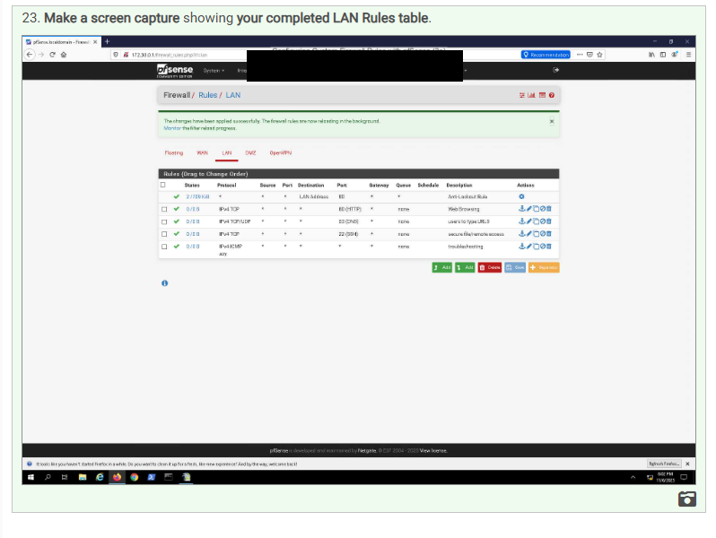
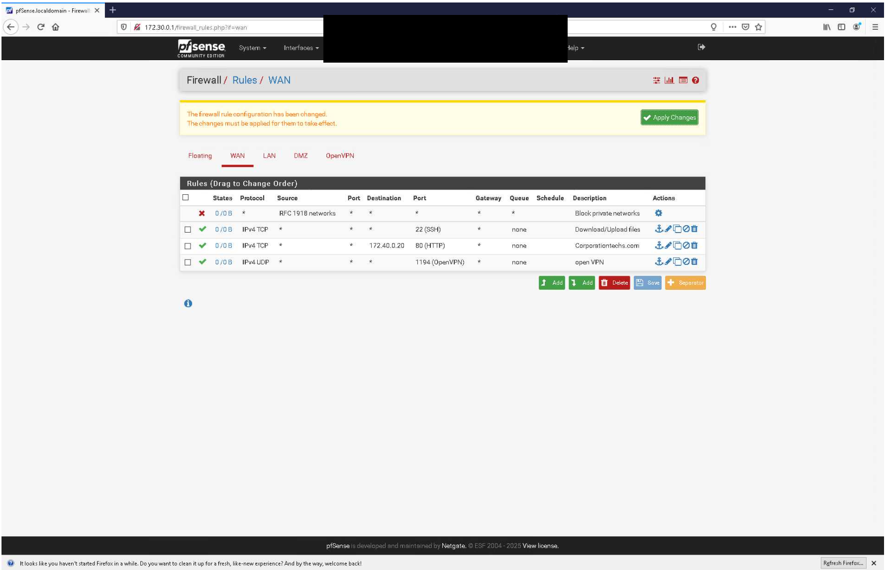
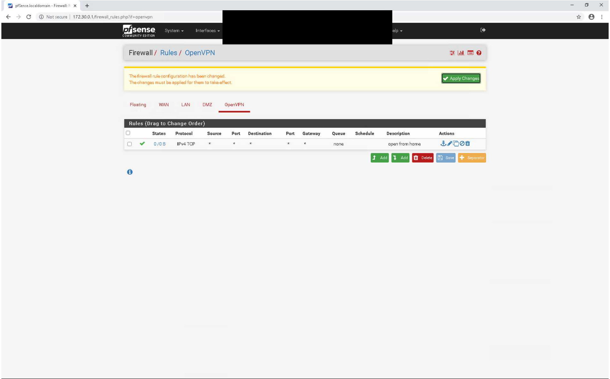
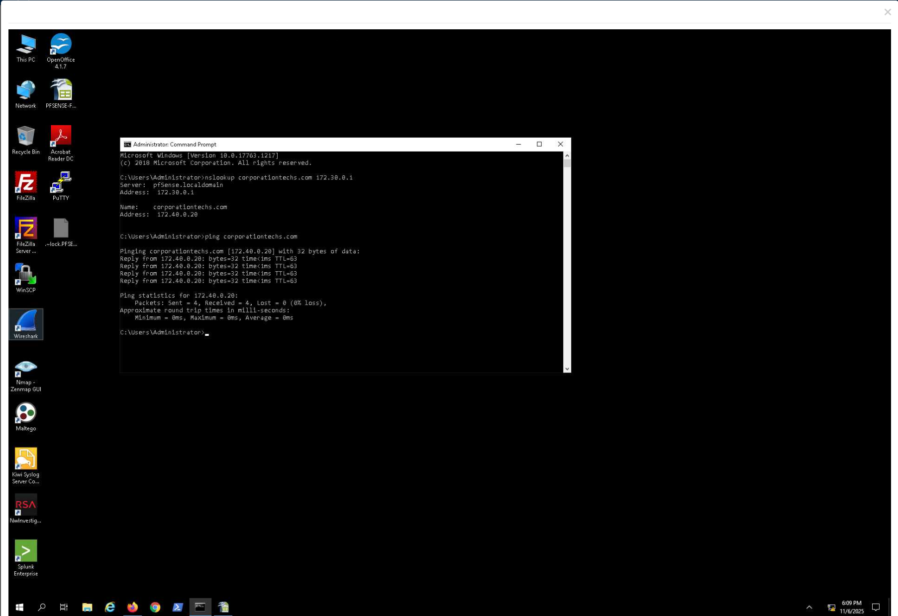
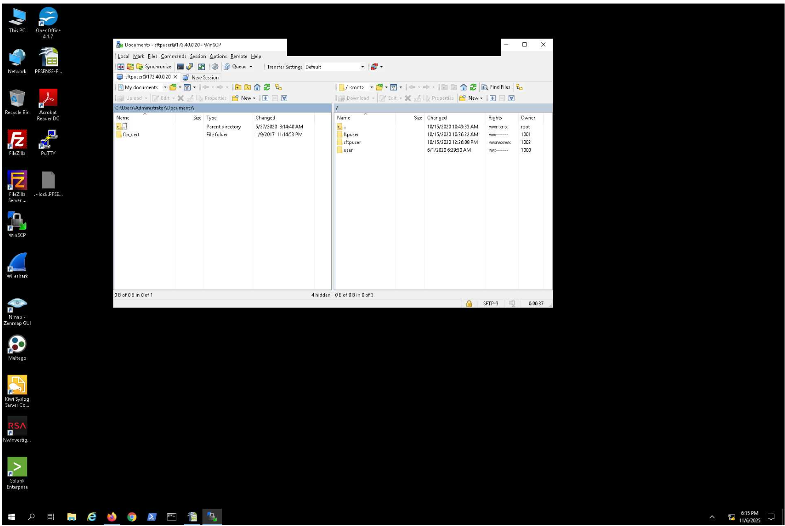
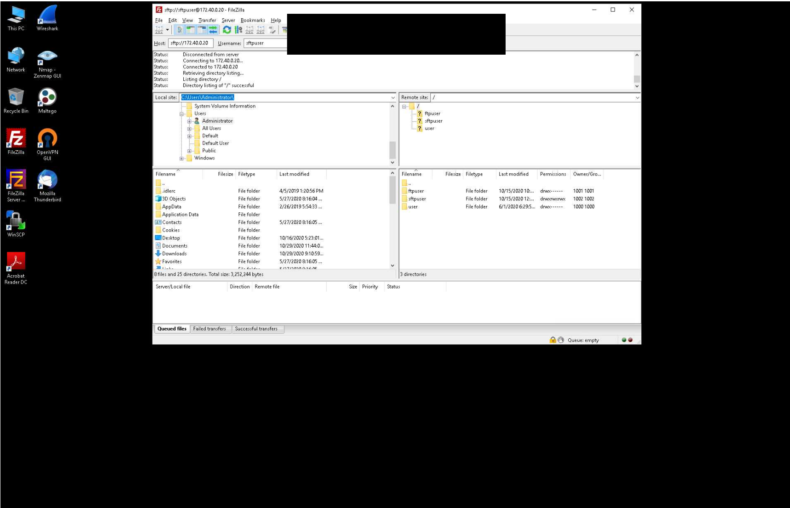
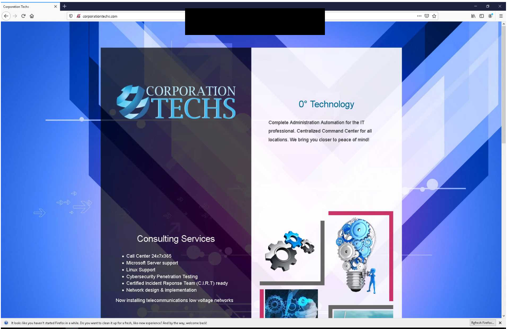
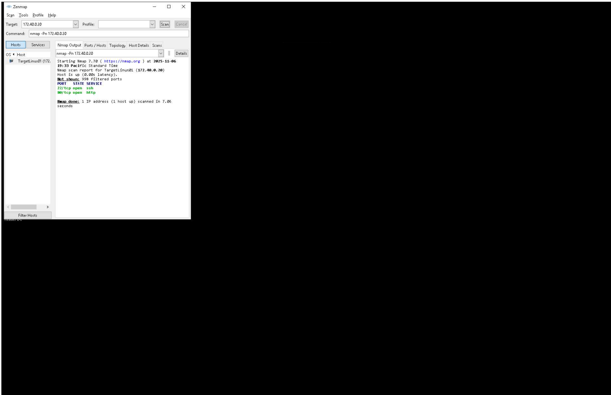

# pfSense Custom Firewall Rules and Traffic Validation

**Author:** Marcus Draper  
**Environment:** Academic virtual lab  
**Status:** Core rule configuration and several connectivity tests documented; additional validation remains unfinished.

## Overview

In this lab, I planned and configured custom pfSense firewall rules for LAN, WAN, and OpenVPN traffic. I tested DNS resolution, ICMP connectivity, web access, and SFTP connectivity, then used Nmap to inspect reachable TCP services from the remote Windows machine.

This repository documents my completed work, the results visible in my screenshots, and the tests I still need to finish. It does not contain a deployable pfSense configuration export.

## Skills demonstrated

- Planning firewall access by interface, protocol, destination, and port.
- Configuring pfSense pass rules for HTTP, DNS, SSH, ICMP, and OpenVPN-related traffic.
- Testing name resolution and connectivity with `nslookup` and `ping`.
- Establishing SFTP sessions using WinSCP and FileZilla.
- Checking service exposure with Nmap/Zenmap.
- Comparing intended rules with the actual configuration and identifying validation gaps.

## Lab environment

| Component | Address shown in evidence | Role |
| --- | --- | --- |
| pfSense LAN | 172.30.0.1 | Internal gateway and DNS server used in testing |
| pfSense WAN | 202.20.1.1 | External interface shown in the lab topology |
| vWorkstation | 172.30.0.2 | Internal Windows workstation |
| TargetWindows01 | 172.30.0.10 | Internal Windows host |
| RemoteWindows01 | 10.0.1.2 | Remote test client |
| TargetLinux01 / tested service host | 172.40.0.20 | HTTP and SFTP target shown in test results |

**Evidence discrepancy:** The supplied topology labels TargetLinux01 as `172.40.0.2`, while DNS, SFTP, the WAN HTTP rule, and Nmap show `172.40.0.20`. This write-up uses the address actually tested and preserves the discrepancy rather than assuming the topology is accurate.

## Rule configuration

### LAN

The LAN rule table shows the existing anti-lockout rule plus these custom IPv4 pass rules:

| Protocol | Destination port | Purpose |
| --- | --- | --- |
| TCP | 80 | HTTP web browsing |
| TCP/UDP | 53 | DNS resolution |
| TCP | 22 | SSH/SFTP access |
| ICMP | Not applicable | Connectivity troubleshooting |

The custom rules use broad source and destination matches in this academic exercise. The LAN screenshot includes a successful apply confirmation.



### WAN

The WAN screenshot shows:

| Action/protocol | Destination | Port | Description |
| --- | --- | --- | --- |
| Block | Any; source RFC1918 networks | Any | Block private networks |
| Pass TCP | Any | 22 | Download/Upload files |
| Pass TCP | 172.40.0.20 | 80 | Corporationtechs.com |
| Pass UDP | Any | 1194 | open VPN |

**Configuration caveat:** This screenshot still displays **Apply Changes**. It proves the rules were entered, but does not by itself establish that these exact saved changes were active. Later remote SFTP and HTTP tests show those services were reachable at test time.



### OpenVPN interface

An IPv4 TCP pass rule with any source, destination, and port is shown with the description `open from home`. This screenshot also has pending changes. It does not demonstrate a successful VPN connection or a working tunnel.



## Tests and observed results

| Test | Evidence | Observed result | Limit of the evidence |
| --- | --- | --- | --- |
| DNS query | `nslookup corporationtechs.com 172.30.0.1` | Name resolves to 172.40.0.20 | One lab name was tested |
| Internal ping | `ping corporationtechs.com` | Four replies; 0% packet loss | Does not validate WAN ICMP access |
| Internal SFTP | WinSCP session to 172.40.0.20 | Remote directory listing visible; SFTP-3 shown | No completed file transfer is shown |
| Remote SFTP | FileZilla on RemoteWindows01 | Connected to 172.40.0.20; directory listing successful | No completed file transfer is shown |
| Remote HTTP | Browser on RemoteWindows01 | Corporation Techs lab page loads | Does not validate HTTPS |
| Remote TCP scan | `nmap -Pn 172.40.0.20` | 22/tcp and 80/tcp open; 998 ports filtered | Default scanned TCP set only; UDP/1194 was not tested |

### DNS and ICMP

```text
nslookup corporationtechs.com 172.30.0.1
ping corporationtechs.com
```

The DNS query returned `172.40.0.20`. The ping received four replies with no loss, confirming name resolution and ICMP reachability from the internal workstation at that time.



### SFTP access

The screenshots show authenticated SFTP sessions and readable remote directories. I treat these as connection tests, not proof of a completed upload or download.





### Remote HTTP access

The remote Windows browser successfully loaded the lab website.



### Nmap validation

```text
nmap -Pn 172.40.0.20

Not shown: 998 filtered ports
PORT   STATE SERVICE
22/tcp open  ssh
80/tcp open  http
```

The result is consistent with reachable SSH and HTTP services from the remote test client. It does not prove that all other ports were scanned or that pfSense alone caused every filtered result. The `-Pn` option skips host discovery, so the scan is not evidence of successful ICMP ping.



## Findings and improvements

- The worksheet labels the troubleshooting rule as TCP, but the pfSense LAN table correctly shows ICMP. ICMP has no TCP/UDP port number.
- The WAN SSH rule's destination is any in the UI, while the worksheet intends the service host. A follow-up should restrict the destination and authorized source addresses.
- The WAN UDP/1194 rule also has an any destination in the screenshot, while the worksheet names the WAN address. This needs reconciliation before describing it as a scoped VPN rule.
- The OpenVPN interface rule is broad and TCP-only. Required services should be identified and allowed explicitly, with separate evidence of tunnel establishment and traffic through it.
- HTTP/80 is useful for the lab test; a production service should use an appropriate encrypted configuration.

## Remaining work

- [ ] Capture applied WAN and OpenVPN rule tables.
- [ ] Reconcile worksheet destinations with saved rules and resolve the topology address discrepancy.
- [ ] Finish the email delivery test and capture the result.
- [ ] Generate the WAN ICMP attempt and inspect its firewall log entry.
- [ ] Complete the EasyRule/EasyPass ICMP exercise and capture the resulting WAN rule.
- [ ] Capture before-and-after WAN ICMP results.
- [ ] Validate OpenVPN tunnel establishment and permitted traffic.
- [ ] Demonstrate a completed SFTP upload/download if file transfer is claimed.

## Lessons learned

This exercise connected firewall rule planning with observable service behavior. Successful application tests and port scans provide useful evidence, but they do not validate every rule or every protocol. Separating configured rules, applied changes, and tested outcomes makes the documentation more accurate and gives me a clear plan for finishing the lab.

## Repository contents

- `screenshots/`: supporting screenshots of my work and observed results.
- [Evidence index](docs/evidence-index.md): screenshot descriptions and limitations.
- [Publishing guide](docs/publishing-guide.md): suggested GitHub name, description, and upload steps.

## Attribution

Based on the academic exercise **Configuring Custom Firewall Rules with pfSense (3e)**, *Network Security, Firewalls, and VPNs, Third Edition — Lab 07*. The narrative is a portfolio write-up of my work; the repository is not a reproduction of the complete lab guide. Screenshots include the training environment's interfaces and labels. No ownership of third-party course materials is claimed.
